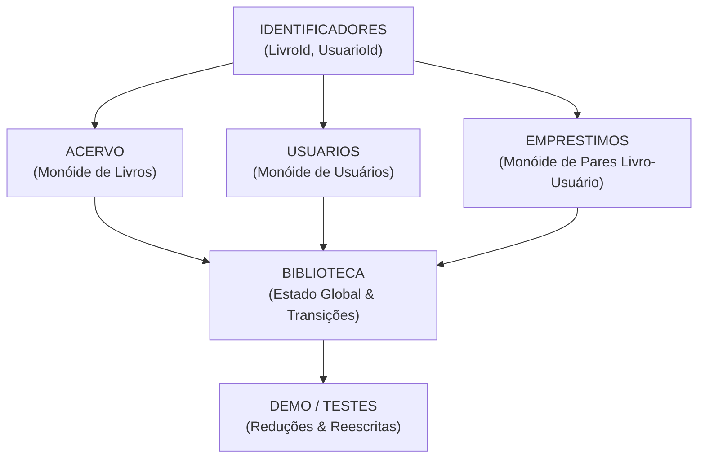

# Planejamento da Especificação Algébrica e Lista de Tarefas (DIM0167)

Documento de acompanhamento, modelagem formal e gerenciamento de tarefas para a implementação da especificação algébrica do **Sistema de Biblioteca** em **CafeOBJ**.

---

## 1. Planejamento da Modelagem Algébrica

A especificação adota uma decomposição modular em camadas, onde cada domínio conceitual é modelado como uma estrutura algébrica independente (baseada em **Monóides** para coleções) e combinada no módulo integrador `BIBLIOTECA`.

### 1.1. Estrutura dos Módulos e Assinaturas

- **`identificadores.mod`**:
  - Sorts: `[ LivroId UsuarioId ]`
  - Propósito: identificadores atômicos e únicos de livros e usuários.

- **`acervo.mod`**:
  - Sort: `[ Acervo ]`
  - Construtores de monóide: `vazioAcervo`, `[livro_]`, `__` (associativo, comutativo e com elemento neutro).
  - Operadores definidos: `pertenceAcervo?`, `qtdAcervo`.

- **`usuarios.mod`**:
  - Sort:
  - Construtores de monóide: 
  - Operadores definidos: 

- **`emprestimo.mod`**:
  - Sorts: 
  - Construtores: 
  - Operadores definidos:

- **`biblioteca.mod`**:
  - Sort: 
  - Construtor do estado global: 
  - Operadores observadores:
  - Operadores mutadores (transição de estado): 

---

## 2. Lista de Tarefas 

Lista estruturada diretamente a partir dos requisitos exigidos no documento oficial **Trabalho-Pratico.pdf**:

### 2.1. Funcionalidades do Sistema
- [ ] Adicionar um livro ao acervo (`adicionarLivro`)
- [ ] Remover um livro do acervo (`removerLivro`)
- [x] Registrar um usuário (operação de união em `colecao-usuarios.mod`)
- [x] Remover um usuário (`removerUsuario` em `colecao-usuarios.mod`)
- [x] Realizar o empréstimo de um livro (operação de união em `emprestimo.mod`)
- [x] Realizar a devolução de um livro (`devolver` em `emprestimo.mod`)
- [x] Verificar se determinado livro pertence ao acervo (`pertenceAcervo?` em `acervo.mod`)
- [ ] Verificar se determinado livro está disponível (`disponivel?` em `biblioteca.mod`)
- [x] Verificar se determinado usuário possui determinado livro (`temLivro?` em `emprestimo.mod`)
- [x] Consultar a quantidade de livros do acervo (`qtdAcervo` em `acervo.mod`)
- [x] Consultar a quantidade de livros emprestados (`qtdEmprestimos` em `emprestimo.mod`)
- [x] Consultar a quantidade de usuários registrados (`qtdUsuarios` em `colecao-usuarios.mod`)

### 2.2. Regras Mínimas do Sistema
- [ ] **Regra 1**: Um livro não pode ser emprestado se não pertencer ao acervo
- [ ] **Regra 2**: Um livro não pode ser emprestado se já estiver emprestado
- [ ] **Regra 3**: A devolução de um livro deve torná-lo novamente disponível
- [ ] **Regra 4**: Um usuário só pode devolver um livro que esteja emprestado a ele
- [ ] **Regra 5**: A remoção de um livro deve ser possível apenas quando ele estiver disponível
- [ ] **Regra 6**: A identificação de cada livro deve ser única
- [ ] **Regra 7**: Quantidade de livros disponíveis + livros emprestados = quantidade total de livros do acervo

### 2.3. Requisitos Gerais da Especificação Algébrica
- [ ] **4.1. Assinatura - Sorts**: Sorts `LivroId`, `UsuarioId` e `Acervo` declarados
- [ ] **4.1. Assinatura - Operadores e Aridades**: Declaração completa dos operadores com construtores `{constr}` e definidos
- [x] **4.2. Variáveis**: Declaração explícita de variáveis tipadas em `acervo.mod`
- [ ] **4.3. Equações**:
  - [x] Casos normais e casos base/vazio definidos em `acervo.mod`
  - [ ] Casos normais e casos de fronteira em `usuarios.mod`, `emprestimo.mod` e `biblioteca.mod`
  - [ ] Tratamento de elemento procurado inexistente nas coleções
- [ ] **4.4. Estruturas de Dados**: Modelagem algébrica das coleções como monóides comutativos com identidade

### 2.4. Tratamento de Situações Inválidas (Mínimo de 5 Situações)
- [ ] Situação 1: Emprestar livro inexistente no acervo
- [ ] Situação 2: Emprestar livro já emprestado
- [ ] Situação 3: Emprestar livro para usuário não registrado
- [ ] Situação 4: Devolver livro não emprestado ao usuário
- [ ] Situação 5: Remover livro que está emprestado no momento
- [ ] Situação 6: Remover usuário com empréstimo ativo pendente
- [ ] Situação 7: Adicionar livro com ID já existente no acervo

### 2.5. Parte Experimental e Testes de Reescrita (Mínimo de 10 Termos)
- [ ] Termos cobrindo operações básicas
- [ ] Termos cobrindo operações compostas
- [ ] Pelo menos dois casos inválidos testados
- [ ] Exemplos relacionados a todas as 7 regras especificadas
- [ ] Demonstração das reduções (`red`) via CafeOBJ

### 2.6. Relatório Final e Análise 
- [ ] Justificativa da escolha dos sorts e operadores
- [ ] Avaliação da representatividade do modelo em relação ao sistema real
- [ ] Identificação de características do mundo real que não foram representadas
- [ ] Análise das propriedades matemáticas expressas (ex.: monóides e conservação de cardinalidade)
- [ ] Explicação formal de como a especificação impede/trata operações inválidas
- [ ] Redação do relatório em PDF (4 a 16 páginas) para envio até 30/10 ao professor
