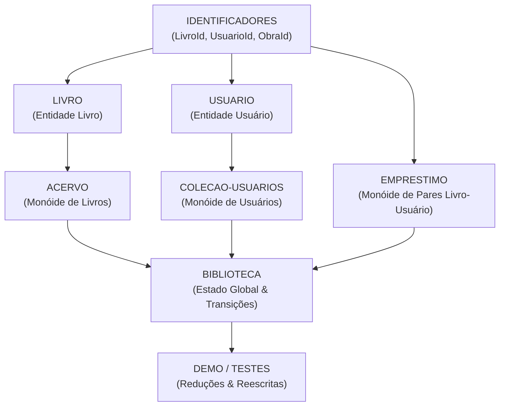

# Planejamento da Especificação Algébrica e Lista de Tarefas (DIM0167)

Documento de acompanhamento, modelagem formal e gerenciamento de tarefas para a implementação da especificação algébrica do **Sistema de Biblioteca** em **CafeOBJ**.

---

## 1. Planejamento da Modelagem Algébrica

A especificação adota uma decomposição modular em camadas, onde cada domínio conceitual é modelado como uma estrutura algébrica independente (baseada em **Monóides** para coleções) e combinada no módulo integrador `BIBLIOTECA`.

### 1.1. Estrutura dos Módulos e Assinaturas

- **`identificadores.mod`**:
  - Sorts: `[ LivroId UsuarioId ObraId ]`
  - Propósito: identificadores atômicos e únicos de exemplares físicos (`LivroId`), usuários (`UsuarioId`) e obras/edições catalogadas (`ObraId`).

- **`livro.mod`**:
  - Sort: `[ Livro ]`
  - Construtor: `op livro : LivroId ObraId String String Nat -> Livro { constr }`
  - Projeções (Getters): `id`, `obra`, `titulo`, `autor`, `ano`.
  - Predicado: `pred valido? : Livro` (título e autor não vazios, ano positivo).

- **`usuario.mod`**:
  - Sort: `[ Usuario ]`
  - Construtor: `op usuario : UsuarioId String String -> Usuario { constr }`
  - Projeções (Getters): `id`, `nome`, `email`.
  - Predicado: `pred valido? : Usuario` (nome e e-mail não vazios).

- **`acervo.mod`**:
  - Sorts: `[ Livro < LivroOuErro ]`, `[ Livro < Acervo ]` (multiconjunto monoidal)
  - Construtores de monóide: `vazioAcervo`, `__ : Acervo Acervo -> Acervo { constr assoc comm id: vazioAcervo }`
  - Construtores de erro: `livroInexistente`, `livroDuplicado`
  - Modificadores / Operadores: `iniciarAcervo`, `adicionarLivro` (com guarda de pertinência), `removerDoAcervo` (remoção total por ID).
  - Consultas: `buscarLivro` (via `filtrarId` e `resultadoBusca`), `qtdAcervo`, `qtdExemplaresObra`, `buscarTitulo`, `tituloDeAutor`.
  - Predicados de integridade: `pertenceAcervo?`, `idsUnicos?`, `todosValidos?`.

- **`colecao-usuarios.mod`**:
  - Sorts: `[ Usuario < ConjuntoUsuarios ]` (multiconjunto monoidal)
  - Construtores de monóide: `vazioUsuarios`, `__ : ConjuntoUsuarios ConjuntoUsuarios -> ConjuntoUsuarios { constr assoc comm id: vazioUsuarios }`
  - Modificadores: `iniciarColecao`, `adicionarUsuario` (com guarda de pertinência), `removerUsuario` (remoção total por ID).
  - Consultas: `qtdUsuarios`.
  - Predicado: `pertence? : UsuarioId ConjuntoUsuarios`.

- **`emprestimo.mod`**:
  - Sorts: `[ Emprestimo < ConjuntoEmprestimos ]` (multiconjunto monoidal)
  - Construtores de monóide: `semEmprestimo`, `op emprestar : LivroId UsuarioId -> ConjuntoEmprestimos { constr }`, `__ : ConjuntoEmprestimos ConjuntoEmprestimos -> ConjuntoEmprestimos { constr assoc comm id: semEmprestimo }`
  - Modificadores: `iniciarEmprestimos`, `op emprestar : LivroId UsuarioId ConjuntoEmprestimos -> ConjuntoEmprestimos`, `devolver : LivroId ConjuntoEmprestimos -> ConjuntoEmprestimos`.
  - Consultas: `qtdEmprestimos`.
  - Predicados: `emprestado? : LivroId ConjuntoEmprestimos`, `temLivro? : UsuarioId LivroId ConjuntoEmprestimos`.

- **`biblioteca.mod`**:
  - Sort: `[ Biblioteca ]` (visível).
  - Construtor canônico: `op biblioteca : Acervo ConjuntoUsuarios ConjuntoEmprestimos -> Biblioteca { constr }`.
  - Estado inicial: `bibliotecaVazia = biblioteca(vazioAcervo, vazioUsuarios, semEmprestimo)`.
  - Projeções: `acervo`, `usuarios`, `emprestimos`.
  - Consultas e observadores de estado: `pertenceAcervo?`, `usuarioRegistrado?`, `emprestado?`, `temLivro?`, `disponivel?`.
  - Predicados de consistência global: `valido? : Biblioteca` e auxiliar `emprestimosValidos? : Biblioteca`.
  - Contagens globais: `qtdAcervo`, `qtdUsuarios`, `qtdEmprestimos`, `qtdDisponiveis` (via auxiliar `contarDisponiveis`).
  - *Pendente*: Operações de transição de estado da biblioteca com pré-condições (ex.: `adicionarLivro`, `removerLivro`, `registrarUsuario`, `removerUsuario`, `emprestarLivro`, `devolverLivro`) e invariante global de consistência.

---

## 2. Lista de Tarefas 

Lista estruturada a partir dos requisitos exigidos no documento oficial **Trabalho-Pratico.pdf**:

### 2.1. Funcionalidades do Sistema
- [x] Modelar representação de acervo (`acervo.mod`) com monóides e identificação por `LivroId`
- [x] Modelar representação de usuários (`usuario.mod` e `colecao-usuarios.mod`) com monóides e identificação por `UsuarioId`
- [x] Modelar representação de empréstimos (`emprestimo.mod`) relacionando `LivroId` e `UsuarioId`
- [x] Representar o estado global, o estado vazio (`bibliotecaVazia`) e as projeções em `biblioteca.mod`
- [x] Adicionar livro na coleção (`adicionarLivro` em `acervo.mod`)
- [x] Remover livro da coleção (`removerDoAcervo` em `acervo.mod`)
- [x] Registrar usuário na coleção (`adicionarUsuario` em `colecao-usuarios.mod`)
- [x] Remover usuário da coleção (`removerUsuario` em `colecao-usuarios.mod`)
- [x] Realizar empréstimo na coleção (`emprestar` em `emprestimo.mod`)
- [x] Realizar devolução na coleção (`devolver` em `emprestimo.mod`)
- [x] Verificar se determinado livro pertence ao acervo (`pertenceAcervo?` em `acervo.mod` e `biblioteca.mod`)
- [x] Verificar se determinado livro está disponível (`disponivel?` em `biblioteca.mod`)
- [x] Verificar se determinado usuário possui determinado livro (`temLivro?` em `emprestimo.mod` e `biblioteca.mod`)
- [x] Consultar a quantidade de livros do acervo (`qtdAcervo` em `acervo.mod` e `biblioteca.mod`)
- [x] Consultar a quantidade de livros emprestados (`qtdEmprestimos` em `emprestimo.mod` e `biblioteca.mod`)
- [x] Consultar a quantidade de usuários registrados (`qtdUsuarios` em `colecao-usuarios.mod` e `biblioteca.mod`)
- [x] Consultar contagens diretamente no estado global, incluindo `qtdDisponiveis`
- [x] **Transições globais com condições em `biblioteca.mod`**:
  - [x] `adicionarLivro(Livro, Biblioteca) -> Biblioteca`
  - [x] `removerLivro(LivroId, Biblioteca) -> Biblioteca` (somente se disponível)
  - [x] `registrarUsuario(Usuario, Biblioteca) -> Biblioteca`
  - [x] `removerUsuario(UsuarioId, Biblioteca) -> Biblioteca` (somente sem empréstimos ativos via `temLivro?(UID, ES)`)
  - [x] `emprestarLivro(LivroId, UsuarioId, Biblioteca) -> Biblioteca` (somente se disponível e usuário registrado)
  - [x] `devolverLivro(LivroId, UsuarioId, Biblioteca) -> Biblioteca` (somente se o livro estiver com o usuário)

### 2.2. Regras Mínimas do Sistema
- [x] **Regra 1**: Um livro não pode ser emprestado se não pertencer ao acervo *(guardada em `emprestarLivro` via `disponivel?`)*
- [x] **Regra 2**: Um livro não pode ser emprestado se já estiver emprestado *(guardada em `emprestarLivro` via `disponivel?`)*
- [x] **Regra 3**: A devolução de um livro deve torná-lo novamente disponível *(garantida por `devolverLivro`)*
- [x] **Regra 4**: Um usuário só pode devolver um livro que esteja emprestado a ele *(guardada em `devolverLivro` via `temLivro?`)*
- [x] **Regra 5**: A remoção de um livro deve ser possível apenas quando ele estiver disponível *(guardada em `removerLivro` via `disponivel?`)*
- [x] **Regra 6**: A identificação de cada livro deve ser única *(especificada pelo predicado `idsUnicos?` em `acervo.mod` e validada nos testes)*
- [x] **Regra 7**: Quantidade de livros disponíveis + livros emprestados = quantidade total de livros do acervo *(validada matematicamente pelos observadores de `biblioteca.mod`)*

### 2.3. Requisitos Gerais da Especificação Algébrica
- [x] **4.1. Assinatura - Sorts**: Sorts `LivroId`, `UsuarioId`, `ObraId`, `Livro`, `Usuario`, `Acervo`, `ConjuntoUsuarios`, `Emprestimo`, `ConjuntoEmprestimos`, `Biblioteca`, `LivroOuErro` declarados
- [x] **4.1. Assinatura - Operadores e Aridades**: Declaração completa dos operadores com `{constr}` e operadores definidos
- [x] **4.2. Variáveis**: Declaração explícita de variáveis tipadas em todos os módulos
- [x] **4.3. Equações**:
  - [x] Casos normais e casos base/vazio definidos em todos os módulos
  - [x] Casos de fronteira nas coleções e observadores globais
  - [x] Tratamento de elemento procurado inexistente (`livroInexistente`, retorno booleano `false`, preservação de coleção)
  - [ ] Equações de transição de estado da biblioteca com tratamento de pré-condições
- [x] **4.4. Estruturas de Dados**: Modelagem algébrica das coleções como monóides comutativos com identidade (`vazioAcervo`, `vazioUsuarios`, `semEmprestimo`)

### 2.4. Tratamento de Situações Inválidas (Mínimo de 5 Situações)
- [x] **Situação 1 (Acervo)**: Buscar livro inexistente no acervo $\to$ retorna construtor de erro `livroInexistente`
- [x] **Situação 2 (Acervo)**: Buscar livro em acervo inconsistente com ID duplicado $\to$ retorna `livroDuplicado`
- [x] **Situação 3 (Acervo/Usuários)**: Tentar remover elemento inexistente $\to$ preserva a coleção intacta de forma idempotente
- [x] **Situação 4 (Acervo/Usuários)**: Tentar adicionar elemento com ID já existente $\to$ não duplica o ID na coleção
- [x] **Situação 5 (Empréstimo)**: Tentar devolver livro que não está registrado como emprestado $\to$ preserva a coleção inalterada
- [ ] **Situações inválidas no nível global da Biblioteca** *(pendente implementação das transições guardadas)*:
  - [ ] Emprestar livro que não pertence ao acervo
  - [ ] Emprestar livro já emprestado
  - [ ] Emprestar livro para usuário não registrado
  - [ ] Usuário tentar devolver livro não emprestado a ele
  - [ ] Tentar remover do acervo livro que se encontra emprestado
  - [ ] Tentar remover usuário que possui empréstimos pendentes

### 2.5. Parte Experimental e Testes de Reescrita
- [x] Implementação de termos de teste cobrindo operações básicas e projeções (`demo.cafe` - Partes 1 a 5)
- [x] Implementação de termos cobrindo operações compostas e cardinalidade (`demo.cafe` e `teste-estado-biblioteca.cafe`)
- [x] Casos inválidos testados via reescrita (`livroInexistente`, `livroDuplicado`, remoção de ausente)
- [x] Suíte de testes automatizados com 101 asserções booleanas cobrindo todas as leis algébricas e observadores (`testes.cafe` e `scripts/testar.py` passando 100%)
- [ ] Exemplos de reescrita cobrindo as transições globais de estado da biblioteca com bloqueio de operações inválidas

### 2.6. Relatório Final e Análise
- [ ] Justificativa formal da escolha dos sorts e operadores monoidais
- [ ] Avaliação da representatividade do modelo algébrico em relação ao sistema do mundo real
- [ ] Identificação de características do mundo real que não foram representadas (ex.: datas de devolução, multas, limites físicos)
- [ ] Análise das propriedades matemáticas expressas (monóides comutativos, idempotência em filtros, conservação de cardinalidade)
- [ ] Explicação formal de como a especificação impede/trata operações inválidas via supersorts e pré-condições
- [ ] Redação do relatório em PDF (4 a 16 páginas) para envio
